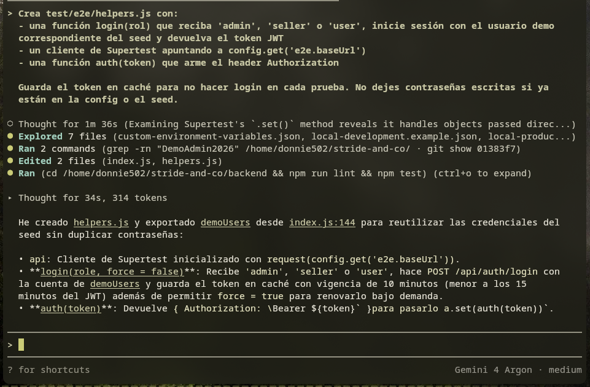
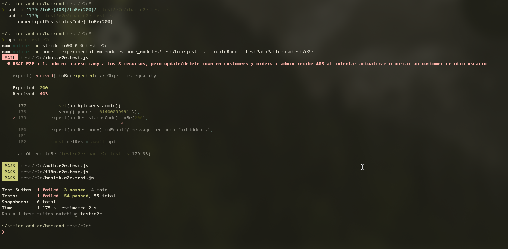
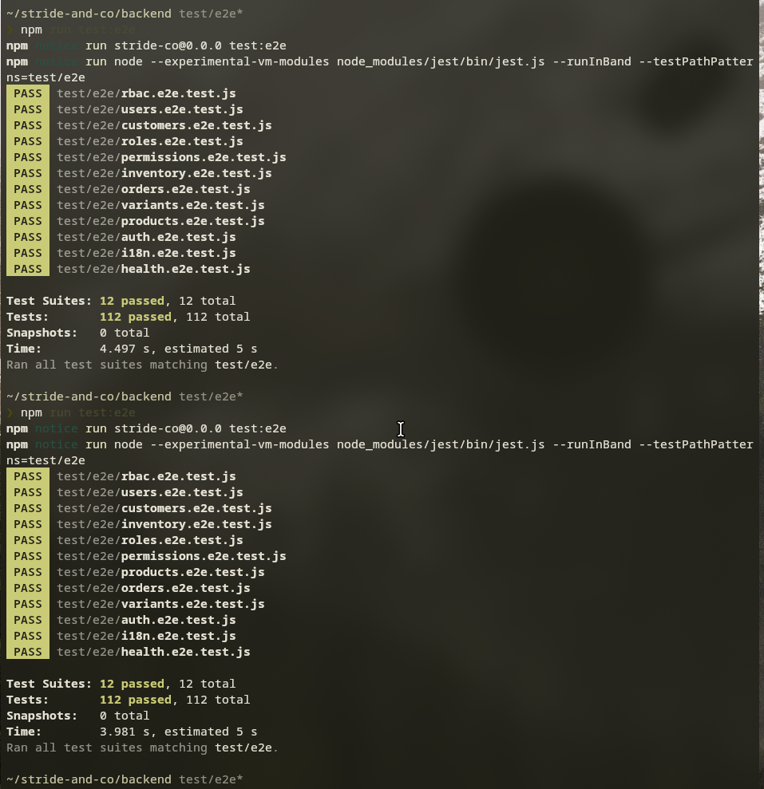
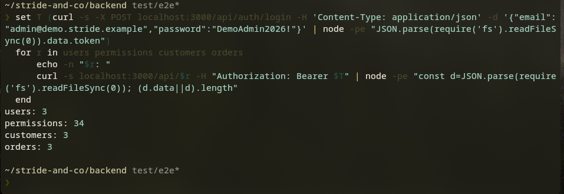

# Pruebas E2E con Antigravity

## Qué se hizo

Usamos Antigravity para generar las pruebas E2E del backend. Están en `backend/test/e2e/` y usan Jest y Supertest.

Estas pruebas no importan `app.js`. Le pegan a la API ya corriendo, en la URL de `config.get('e2e.baseUrl')`.

Hay 12 suites:

- `health.e2e.test.js`
- `auth.e2e.test.js`
- `rbac.e2e.test.js`
- `i18n.e2e.test.js`
- una por recurso: `users`, `permissions`, `roles`, `products`, `variants`, `inventory`, `customers` y `orders`

Cada suite crea sus propios datos con un sufijo único (`Date.now()`) y los borra al final. Los datos demo del seed no se modifican.

Los prompts los fuimos mandando uno por uno. Revisamos lo que generó y lo subimos en commits separados por suite.

## Prompts usados

Estos son los prompts en el orden en que se mandaron.

### 0. Contexto

```text
Estoy trabajando en el backend de Stride & Co (carpeta backend/), hecho con Node, Express, Sequelize + PostgreSQL y Mongoose + MongoDB. Necesito pruebas E2E con Jest y Supertest que peguen contra la API ya corriendo (no usar request(app), no importar app.js).

Antes de escribir nada, lee: package.json, config/default.json, routes/, controllers/, models/, el seed (para ver los permisos y los usuarios demo), locales/en.json y es.json, el README y las pruebas de la carpeta test/ para copiar el estilo y el sistema de modulos.

Reglas:
- La URL base se lee con config.get('e2e.baseUrl'). No usar process.env.
- Los archivos van en test/e2e/ y se corren con npm run test:e2e.
- Cada prueba debe borrar lo que crea (afterAll) porque la base de produccion es gratis y chica.
- Usar datos unicos en cada corrida (por ejemplo con Date.now()) para poder correr la suite varias veces.
- Los roles son admin, seller y user. El userId de un cliente sale del token, el estado inicial de una orden lo pone el servidor.

Por ahora solo dime que entendiste de la estructura de rutas y de la autenticacion, sin generar codigo.
```

### 0.1 Reglas extra antes de generar código

```text
1. Los datos demo del seed (los 3 customers, las 3 orders, los 2 productos, 2 variantes y su inventario) no se pueden modificar ni borrar en las pruebas. Las pruebas solo crean sus propios datos y solo tocan esos.
2. Como update y delete de customers y orders son :own incluso para admin, cada prueba debe actualizar y borrar con el mismo token que creo el registro. En afterAll limpia con el token del dueno.
3. Para el catalogo hay dependencias: products necesita category_id, variants necesita un product_id, e inventory necesita un variant_id nuevo y unico. Crea la cadena producto -> variante -> inventario y borrala en orden inverso.
4. El token dura 15 minutos. En helpers.js no lo caches para siempre.
5. En orders, revisa en el controller y el modelo como deben mandarse los totals (son Decimal128).
```

### 1. helpers.js

```text
Crea test/e2e/helpers.js con:
- una funcion login(rol) que reciba 'admin', 'seller' o 'user', inicie sesion con el usuario demo correspondiente del seed y devuelva el token JWT
- un cliente de Supertest apuntando a config.get('e2e.baseUrl')
- una funcion auth(token) que arme el header Authorization

Guarda el token en cache para no hacer login en cada prueba. No dejes contrasenas escritas si ya estan en la config o el seed.
```

### 2. health y auth

```text
Crea test/e2e/health.e2e.test.js y test/e2e/auth.e2e.test.js usando helpers.js.
- GET /health debe responder 200 con {"status":"UP"}
- Auth: login correcto devuelve token, login con contrasena mala devuelve 401, una ruta protegida sin token devuelve 401 y con token invalido tambien 401.
Lee el controller de auth para usar las rutas y mensajes reales.
```

### 3. rbac

```text
Crea test/e2e/rbac.e2e.test.js con los 5 escenarios de la tarea de RBAC:
1. admin tiene acceso :any a los 8 recursos, pero en customers y orders update/delete solo funcionan sobre registros propios: probar que admin recibe 403 al intentar editar o borrar un customer u order de otro usuario.
2. seller puede lo que dice la matriz de permisos del seed y recibe 403 en lo demas
3. user solo accede a lo suyo (own) y recibe 403 en recursos ajenos
4. sin token es 401
5. rol sin permiso para la accion es 403
Usa la matriz real del seed para escoger recursos y acciones, no inventes permisos. Si un caso necesita datos, crealos con admin y borralos al final.
```

### 3.1 Corrección en rbac (seller)

```text
En rbac.e2e.test.js, escenario del seller, agrega: seller crea un customer y una order propios y puede actualizarlos (200) y borrarlos; seller recibe 403 al intentar actualizar o borrar el customer y la order de otro usuario. Todo con sufijo unico y limpieza en afterAll.
```

### 4. i18n

```text
Crea test/e2e/i18n.e2e.test.js. Revisa config/i18n.js y los locales. Probar:
- ?lang=es y ?lang=en devuelven el mensaje en ese idioma
- el header Accept-Language: es y en
- ?lang gana sobre Accept-Language
- fr cae en el idioma por defecto (en)
- es-MX se trata como es
Usa un error facil de provocar (por ejemplo un id invalido) y compara contra el texto de los archivos locales, no contra textos copiados a mano.
```

### 5. users

```text
Crea test/e2e/users.e2e.test.js. El body de POST /api/users es { name, lastName, email, roleId, password }. Para roleId usa el id del rol 'user' que obtienes con GET /api/roles como admin (no lo modifiques). Ciclo completo con admin: crear (201), consultar por id (200), listar (200 e incluir el creado), actualizar (200) y confirmar con un GET, eliminar (200) y GET da 404. Verifica que ninguna respuesta incluya password_hash ni salt_key. Agrega: email repetido da 400, body invalido da 400, id mal formado da 400, id inexistente da 404, user y seller reciben 403. Usa Date.now() para el email y borra lo creado en afterAll.
```

### 6. permissions

```text
Crea test/e2e/permissions.e2e.test.js. Body: { key, description }. Mismo ciclo completo con admin, con datos invalidos (400), id mal formado (400), id inexistente (404) y 403 para seller y user. Usa un key unico con Date.now() y limpia al final.
```

### 7. roles

```text
Crea test/e2e/roles.e2e.test.js. Body: { name, description, permissionIds }. Crea antes un permiso de prueba para usarlo en permissionIds y borralo al final, despues del rol. Ciclo completo con admin: crear (201), consultar por id (200), listar (200 e incluir el creado), actualizar (200) y confirmar con un GET, eliminar (200) y GET da 404. Agrega: datos invalidos da 400, id mal formado da 400, id inexistente da 404 y seller y user reciben 403. Usa Date.now() en los nombres y limpia en afterAll.
```

### 8. products

```text
Crea test/e2e/products.e2e.test.js. Body: { name, price, brand, description, active }, sin category_id (no hay tabla de categorias). price debe ser numero >= 0: probar que price negativo y price como texto dan 400. Ciclo completo con admin, GET como seller y user (200), escritura como seller y user da 403. Al consultar por id debe incluir sus variants. Agrega id mal formado (400) e id inexistente (404). Limpia en afterAll.
```

### 9. variants

```text
Crea test/e2e/variants.e2e.test.js. Body: { product_id, sku, size, color, active }. Crea antes un producto de prueba. El sku debe ser unico: probar que repetirlo da 400. Ciclo completo con admin, datos invalidos (400), id mal formado (400), id inexistente (404) y 403 para escritura de seller y user. Limpia primero la variante y luego el producto.
```

### 10. inventory

```text
Crea test/e2e/inventory.e2e.test.js. Body: { variant_id, stock, reserved }. Crea un producto y una variante nuevos para tener un variant_id libre (los de las variantes demo ya tienen inventario). variant_id repetido da 400. Ciclo completo con admin, datos invalidos (400), id mal formado (400), id inexistente (404) y 403 para user. Limpieza en orden inverso: inventario, variante, producto. Revisa el locale antes de comparar mensajes.
```

### 11. customers

```text
Crea test/e2e/customers.e2e.test.js. El userId lo toma el servidor del token: el POST no lo manda y, si lo mandas, se ignora. Un PUT que intente cambiar userId (tambien con operadores $ o rutas con punto) no debe cambiarlo. Cada rol crea y borra sus propios customers con su token. Un user no puede ver ni editar el customer de otro (403) y no puede listar todos (403). id invalido da 400 e id inexistente da 404. Ciclo completo y limpieza en afterAll.
```

### 12. orders

```text
Crea test/e2e/orders.e2e.test.js. Crea antes un customer con el mismo usuario. El POST requiere customerId, items (al menos 1) y totals (subtotal, total); manda los montos como strings decimales. Verifica que el estado inicial sea PENDING con un statusHistory de un elemento puesto por el servidor, aunque el body mande otro. PUT no debe permitir cambiar userId, customerId ni statusHistory. items vacio da 400. En las respuestas los montos son { "$numberDecimal": "..." }. Ciclo completo hasta DELETE y 404. Borra primero la orden y luego el customer, con el token del dueno.
```

### 13. Revisión final

```text
Revisa todos los archivos de test/e2e y dime: alguno depende del orden de ejecucion? alguno deja datos sin borrar? hay textos copiados a mano que deberian venir de los locales? hay pruebas que pasarian aunque la API estuviera mal (por ejemplo sin expect despues de un await)? Corrige lo que encuentres.
```

## Qué corregimos

No aceptamos todo lo que generó Antigravity tal cual. Estas son las correcciones.

### a) helpers.js cargaba el seed

En la primera versión, `helpers.js` importaba el seed para sacar las cuentas demo. Para eso Antigravity modificó `seeders/index.js` y exportó desde ahí los usuarios demo.

No nos gustó porque las pruebas E2E tienen que hablar con la API por HTTP y no cargar código del backend. Lo corregimos: el seed quedó como estaba y las cuentas demo quedaron dentro de `helpers.js`. Ahora `helpers.js` solo usa `config` y `supertest`.

### b) Faltaban pruebas del seller

La primera versión de `rbac.e2e.test.js` no probaba bien al seller. Faltaba que actualizara y borrara lo suyo y que recibiera 403 en lo ajeno. Por eso mandamos el prompt 3.1.

Se agregaron estas pruebas:

- seller crea un customer y una order propios y puede actualizarlos (200) y borrarlos (200)
- seller recibe 403 al intentar actualizar o borrar el customer y la order de otro usuario

### c) Las pruebas encontraron dos bugs reales

Las suites de users y permissions fallaron por problemas del backend, no de las pruebas:

- Crear dos usuarios con el mismo email daba 201. Debía ser 400.
- Un id mal formado, por ejemplo `/api/users/id-invalido`, daba 500. Era un error de Postgres sin manejar: 22P02 (texto inválido) y 22003 (número fuera de rango).

Los arreglamos en el backend:

- `be767ee` fix(users): add unique index on user email
- `30c3524` fix(errors): return 400 for invalid postgres input codes 22P02 and 22003

No cambiamos las pruebas para que pasaran. Siguen esperando 400 y el mensaje de los locales (`common.duplicate` y `common.invalidId`).

### d) Revisión final

En la revisión final (prompt 13), Antigravity cambió varias suites (commit `9c566b1`):

- Cada ciclo CRUD es independiente y no depende del orden de ejecución.
- La limpieza no se pierde si falla un `expect`. Cada id se guarda justo después de crearlo y el `afterAll` borra todo lo guardado.
- Los mensajes se comparan contra `en.json` y `es.json`, no contra textos copiados a mano.
- Después de cada DELETE se hace un GET que debe dar 404.

## Cómo comprobamos que sirven

Una prueba que siempre pasa no sirve. Por eso hicimos tres cosas.

1. Cambiamos a propósito una prueba de rbac. Donde admin debe recibir 403 al editar un customer de otro usuario, pusimos que esperara 200. La prueba falló con `Expected: 200` y `Received: 403`. Después regresamos el cambio.
2. Corrimos toda la suite dos veces seguidas y no hubo errores. Así vimos que una corrida no afecta a la siguiente.
3. Después de las corridas revisamos la base. Quedaron 3 users, 34 permissions, 3 customers y 3 orders, que son los del seed. No quedó basura.

Resultado final: 12 suites y 112 pruebas pasando.

## Cómo correrlas

Desde `backend/`:

1. Levanta PostgreSQL y MongoDB (sección "Preparación local con contenedores propios" del README).
2. Carga los datos demo, porque las pruebas inician sesión con las cuentas demo:

   ```bash
   npm run seed
   ```

3. Arranca la API:

   ```bash
   npm run dev
   ```

4. En otra terminal corre las pruebas:

   ```bash
   npm run test:e2e
   ```

Por defecto le pegan a `http://localhost:3000` (`e2e.baseUrl` en `config/default.json`). Para probar otro servidor, usa la variable `E2E_BASE_URL`:

```bash
E2E_BASE_URL=https://tu-servidor.example npm run test:e2e
```

`npm test` no corre estas pruebas. Solo corre las pruebas con mocks.

## Capturas

Sesión de Antigravity en el proyecto:


Prompt de `helpers.js` y la primera respuesta, donde exporta las cuentas desde el seed (lo que corregimos en el punto a):



Prueba de rbac cambiada a propósito: falla con `Expected: 200` y `Received: 403`:



Dos corridas seguidas de `npm run test:e2e`, las dos con 12 suites y 112 pruebas pasando:



Conteo de registros después de las corridas: solo quedan los datos del seed:



<!-- Pendiente: agregar la captura de la corrida contra Render (npm run test:e2e con E2E_BASE_URL). -->
<!-- Pendiente: agregar la captura de una corrección de Antigravity. -->
